# Extra Color Tools for Substance 3D Painter

Documentation for the Extra Color Tools plugin for Adobe Substance 3D Painter. This repository holds the plugin's
manual and is the place to report problems.

Perceptual color picking for Painter. The plugin adds a dockable panel that picks colors in OKLCH and writes them
straight into the selected Fill layers. It also adds three OKLCH filters that recolor the Base Color of a whole layer.

OKLCH describes a color by lightness (L), chroma (C) and hue (H) the way the eye reads them. Two colors with the same
L look equally light whatever their hue. RGB and HSV do not give you that.

- Application: Substance 3D Painter 12.2 or later (Python plugin, PySide6)
- Platform: Windows
- Language: English

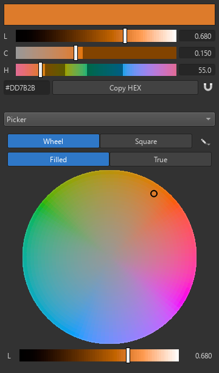

*The panel: the picked color with its L / C / H sliders on top, the tool below.*

## Contents

- [Installing](#installing)
- [The panel](#the-panel)
- [Tools](#tools)
- [Filters](#filters)
- [Notes and limits](#notes-and-limits)
- [Support](#support)

## Installing

1. Copy the `ExtraColorTools` folder into Painter's Python plugins folder:
   `Documents\Adobe\Adobe Substance 3D Painter\python\plugins`.
2. In Painter, choose **Python > Reload Plugins Folder**, then turn on **Python > ExtraColorTools**.
3. The **Extra Color Tools** panel opens. Dock it wherever you like; Painter remembers where it is.

To update the plugin, replace the folder and use **Python > Reload Plugins Folder** again.

## The panel

### How it talks to Painter

- **Select a Fill layer** (or a Fill effect) in the Layer stack. The panel reads its Base Color.
- **Pick a color** in any tool. It goes into every selected Fill layer right away, with undo.
- The panel follows the layer. A change made elsewhere, for example in Painter's own Base Color field, shows up in the panel.
- A **Paint layer** is painted with the brush color, and Painter's API gives plugins no access to the brush. Use
  **Copy HEX** and paste the value into the brush color.
- Problems show as a grey line under the header. Examples: no Fill layer is selected, the fill uses a material, or the fill is a texture.

### Header

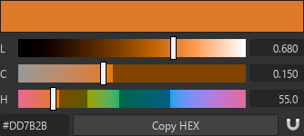

| Control | What it does |
|---|---|
| Preview | The picked color |
| **L** slider | Lightness, 0 black .. 1 white |
| **C** slider | Chroma, 0 grey .. 0.4. The dimmed part of the bar does not fit into sRGB. |
| **H** slider | Hue angle in degrees |
| Number fields | Exact values. Type a value, or use the wheel or the arrow keys. |
| HEX field | The sRGB HEX of the color. Type a HEX value to pick it. |
| **Copy HEX** | Copies the HEX, ready to paste into Painter's own color picker (for brushes) |
| Magnet | Snapping, see below |

Each bar is drawn with the color it would give, so you can see what moving a slider does before you move it.

When chroma is set higher than sRGB can show at that lightness and hue, the panel says so. The color is shown and
written with its chroma reduced until it fits; lightness and hue stay.

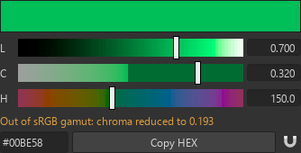

### Snapping

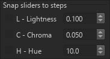

The magnet button opens a menu where L, C and H can each move in fixed steps. Each channel has its own on/off switch
and step size. The magnet turns blue while any channel snaps. With snapping on, the arrow keys and the mouse wheel in
the number fields also step by that size.

### Choosing a tool

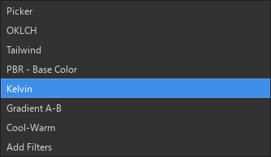

The drop-down under the header switches between the tools. Every tool keeps its state while another one is open, and
the panel opens the tool you used last. A pencil button inside a tool opens that tool's settings.

## Tools

### Picker

 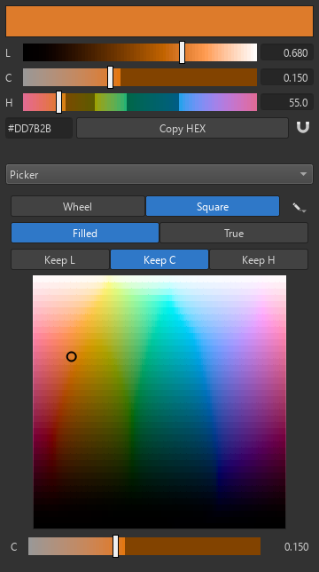

A color wheel or a square.

- **Wheel**: hue around the circle, chroma outwards. Lightness is set with the L slider under the wheel.
- **Square**: two channels on the axes, with the third held fixed.
  - **Keep L**: hue across, chroma up.
  - **Keep C**: hue across, lightness up.
  - **Keep H**: chroma across, lightness up.
  
  The slider under the square moves the fixed channel.
- **Filled** stretches the field edge to edge. Chroma is shown as a share of the most available.
- **True** places colors at their real values, so the field shows the outline of the sRGB gamut.

Pencil menu: **Wheel size**.

### OKLCH

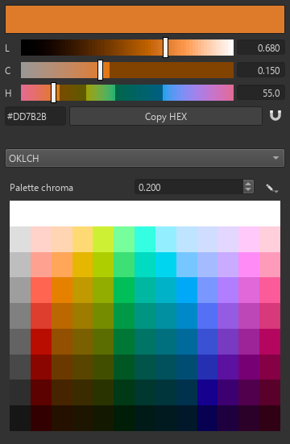 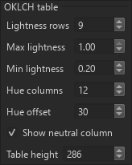

A generated table: lightness in rows, hue in columns, one chroma for every swatch (**Palette chroma**). Each row is
equally light across all hues, so the table works as a ready set of tones. Hover a swatch to see its OKLCH and HEX.

Pencil menu settings:

- **Lightness rows**, **Max lightness**, **Min lightness**
- **Hue columns**, **Hue offset**
- **Show neutral column**, which adds a column of greys
- **Table height**

### Tailwind

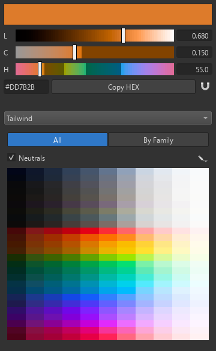 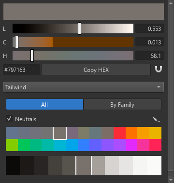

The default colors of Tailwind CSS v4.

- **All**: one row per family, one column per shade (50 to 950).
- **By Family**: pick a family on top, then one of its shades below. Switching to another family picks the same shade there.
- **Neutrals**: shows the nine grey families (slate, gray, zinc, neutral, stone, mauve, olive, mist, taupe).

Pencil menu settings:

- **Light shades first**
- **Family shade height**
- **Table height**

Some Tailwind v4 colors are outside sRGB because they target Display P3. In the panel they are shown with their chroma reduced to fit.

### PBR - Base Color

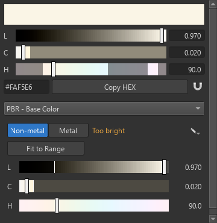

Checks the picked color against commonly used base color limits:

| Group | sRGB limits |
|---|---|
| Non-metal | 30 - 240, or 50 - 243 with **Strict non-metal range** (pencil menu) |
| Metal | 180 - 255 |

- The verdict next to the switch is **In range**, **Too dark** or **Too bright**.
- The L slider of this tool cannot leave the allowed span. The forbidden ends are dimmed.
- **Fit to Range** moves the lightness to the nearest allowed value and keeps hue and chroma.

### Kelvin

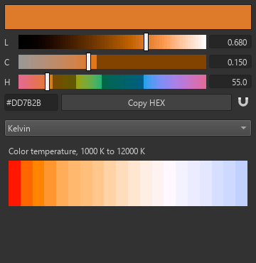

Colors of light from 1000 K to 12000 K, from the black body curve. Each is scaled so the brightest channel is full,
which means a temperature gives a tint and the brightness stays your choice. Hover a swatch to see named reference
points, such as candle flame, incandescent bulb, daylight, overcast sky (D65) and clear blue sky.

### Gradient A-B

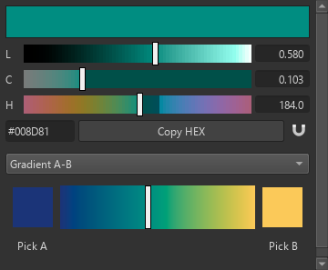

A smooth strip between two colors, mixed in OKLCH. The mix stays even in lightness and does not go muddy in the middle
the way an RGB mix does.

- **Drag on the strip** to pick a color between A and B.
- **Click A or B** to edit that end. While it is framed, every color you pick or adjust in any tool sets it. Click the
  end again, pick from the strip, or click empty space to stop.
- **Pick A / Pick B** take an end from anywhere on screen. Click, move over the screen, click to keep. **Esc** cancels.
- Hue goes the short way around the circle. A grey end borrows the other end's hue.

### Cool-Warm

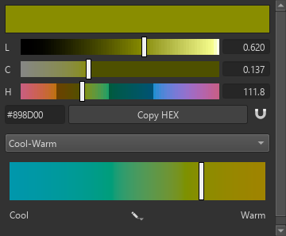

The picked color sits in the middle of a strip, with cooler versions to the left and warmer to the right. Lightness
stays the same, and greys turn into cool and warm greys. The pencil menu sets the **Strength** of the shift and the **Warm hue** (orange by default). The cool hue is the one opposite it.

### Add Filters

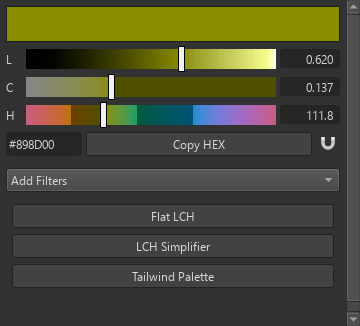

One button per filter. Each button puts its filter on top of the selected layer's content, working on Base Color only,
and selects it, so its settings show in Painter's **Properties**. If an effect is selected, the filter goes above it.
If a mask effect is selected, the filter goes into the layer's content instead.

Unlike the color tools, filters also work on **Paint layers** and on anything else in the layer, such as textures or
materials.

## Filters

All three filters work per pixel in OKLCH and keep every result inside sRGB.

The settings are listed flat in Properties. Each channel (Lightness, Chroma, Hue) has a full-width **Off / On** switch,
and its settings are prefixed with the channel's letter (`L Min`, `C Amount`, `H Value`). The settings of a channel
that is off are hidden.

The example images below were rendered from the filters themselves. A test texture with mixed hues and lightness is
on the left of each one.

### Flat LCH

Brings a texture of mixed lightness to one lightness, or a narrow band of it, while keeping its colors. It can also
hold chroma in a range and pull everything towards one hue.

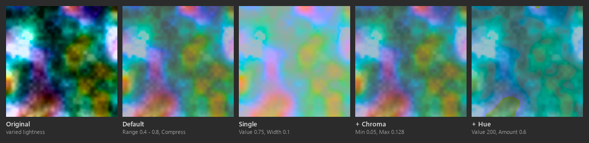

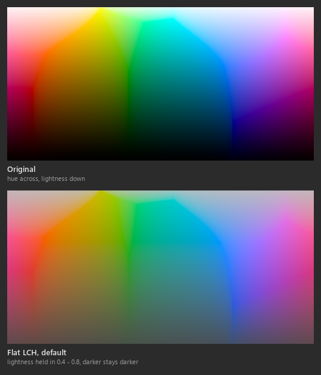

**Lightness** (on by default)

| Setting | Default | Meaning |
|---|---|---|
| L Mode | Range | **Single**: gather lightness around one value. **Range**: fit lightness into L Min - L Max. |
| L Value | 0.75 | *Single.* The lightness the result centres on. At 0.75 every hue keeps the most chroma. |
| L Width | 0.1 | *Single.* Half the width of the band the result fills. 0 gives every pixel exactly L Value. |
| L Power | 0.5 | *Single.* How hard lightness is pulled towards L Value. The farther a pixel is, the more it is pulled. |
| L Min / L Max | 0.4 / 0.8 | *Range.* The darkest and lightest lightness of the result |
| L Fit | Compress | *Range.* **Clip**: values outside the range are pressed to its ends. **Compress**: 0 - 1 is scaled into the range, so darker stays darker and nothing merges. |
| L Balance | 0 | *Range.* Shifts lightness towards L Min (below 0) or L Max (above 0); the ends stay. |
| L Amount | 1 | *Range.* 0 keeps each pixel's own lightness, 1 applies fully |

**Chroma** (off by default)

| Setting | Default | Meaning |
|---|---|---|
| C Min | 0.05 | Chroma below this is raised to it. Nearly grey pixels are raised less, and pure grey stays grey. |
| C Max | 0.128 | Chroma above this is lowered to it. 0.128 is the most chroma every hue reaches at lightness 0.75. |
| C Amount | 1 | 0 keeps each pixel's own chroma, 1 holds it in the range fully |

**Hue** (off by default)

| Setting | Default | Meaning |
|---|---|---|
| H Value | 30 | The hue every pixel turns to, in degrees. Grey stays grey. |
| H Amount | 1 | 0 keeps each pixel's own hue, 1 makes it H Value. The hue turns the short way round. |

### LCH Simplifier

Reduces lightness, chroma and hue to a few values each, for posterized, cel-shaded or stylised looks. Every channel is
off at first, so switch on the ones you want.

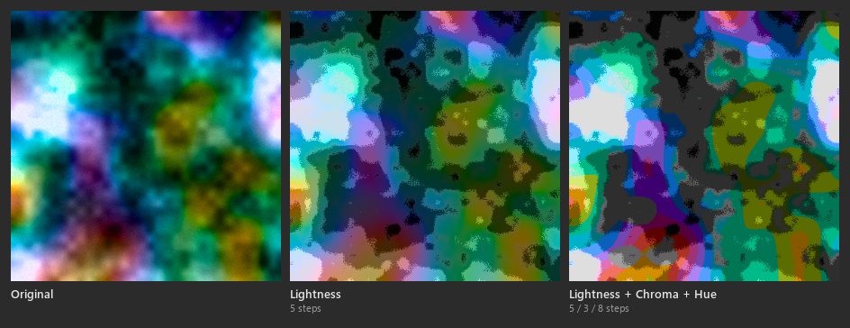

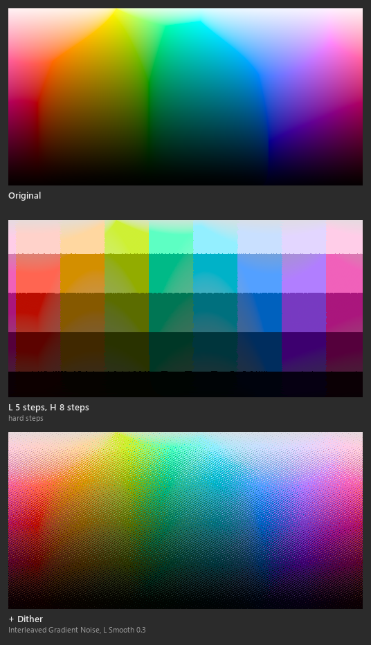

**Lightness**

| Setting | Default | Meaning |
|---|---|---|
| L Steps | 5 | How many tones remain, equally apart from L Min to L Max. With 5 and 0.1 - 0.9 they are 0.1, 0.3, 0.5, 0.7, 0.9. |
| L Min / L Max | 0.1 / 0.9 | The darkest and lightest tone |
| L Fit | Clip | What happens to lightness outside L Min - L Max (see Flat LCH) |
| L Balance | 0 | Shifts the tones towards L Min or L Max |
| L Pre-Blur | 0 | Radius in texels over which the input is averaged before the tone is picked, so noisy textures do not speckle |
| L Smooth | 0 | Softens the step between tones. 0 gives hard steps; 1 blends across the whole gap. |
| L Amount | 1 | 0 keeps the pixel's own lightness, 1 snaps it fully |

**Chroma**

| Setting | Default | Meaning |
|---|---|---|
| C Steps | 5 | Chroma levels from C Min to C Max. Nearly grey pixels get proportionally less, and pure grey stays grey. |
| C Min / C Max | 0 / 0.32 | The bottom and top chroma level |
| C Pre-Blur, C Smooth, C Amount | 0, 0, 1 | As for lightness |

**Hue**

| Setting | Default | Meaning |
|---|---|---|
| H Steps | 12 | The hue circle is cut into this many sectors, and every pixel takes the hue in the middle of its sector |
| H Offset | 30 | The hue of the first sector's middle, in degrees |
| H Pre-Blur, H Smooth, H Amount | 0, 0, 1 | As for lightness |

The Pre-Blur of each channel is independent. A channel decides its level from the blurred color, while each pixel
keeps its own detail in the channels that are off.

**Dithering** (off by default) breaks the steps of a smooth gradient into a fine pattern instead of bands. See
[Dither settings](#dither-settings). Here **Dither Strength** is a share of the gap between levels: at 1 a gradient
keeps its tone on average. Dithering with **Interleaved Gradient Noise** and a little **Smooth** (about 0.3) gives the most faithful tones.

### Tailwind Palette

Moves every pixel to the nearest Tailwind CSS v4 color, measured in OKLab. At default settings the result is made of
exact Tailwind colors only: the official HEX values, pixel for pixel.

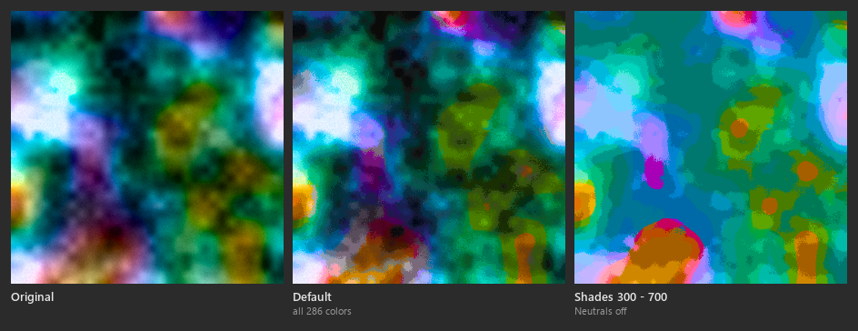

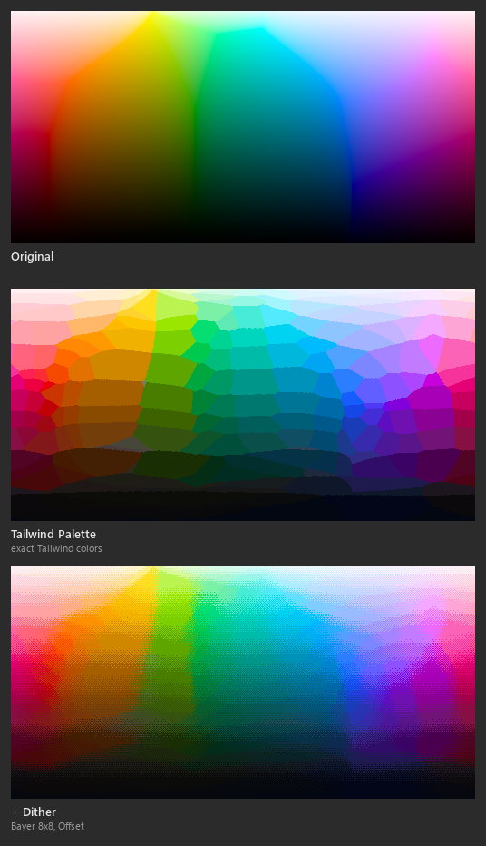

| Setting | Default | Meaning |
|---|---|---|
| Neutrals | On | Use the grey families. Off: even grey pixels take the nearest colored shade. |
| Min Shade / Max Shade | 50 / 950 | The lightest and darkest shade used |
| Shade Fit | Compress | **Clip**: pixels lighter or darker than the shades in use take the end shade. **Compress**: the input's lightness is first scaled into the span of the shades in use, so all of them spread over the picture. |
| Lightness Weight | 1 | How much lightness counts when the nearest color is picked. Above 1 keeps light and shade better; below 1 matches hue better. |
| Softness | 0 | 0: exactly one palette color per pixel. Above 0: a mix of the nearest palette colors, smoother but no longer exact. |
| Pre-Blur | 0 | Radius in texels over which the input is averaged before the color is picked |
| Dither | Off | See [Dither settings](#dither-settings) |
| Dither Mode | Offset | **Offset**: the pattern nudges each pixel before the nearest color is picked. **Two Nearest**: each pixel alternates only between its two nearest palette colors. |
| Lightness Spread / Color Spread | 1 / 1 | *Offset.* How far dithering moves lightness, and hue with chroma |
| Lightness / Chroma / Hue | On | Which channels of the picked color are taken, each with its own **Amount**. Turn off Lightness to recolor with Tailwind hues and keep the texture's light and shade. |

The result is exact Tailwind colors only while all three channels are on at Amount 1 and Softness is 0.

### Dither settings

LCH Simplifier and Tailwind Palette share these:

| Setting | Meaning |
|---|---|
| Dither | On / Off |
| Dither Pattern | **Bayer 4x4**: a regular grid. **Bayer 8x8**: finer. **Interleaved Gradient Noise**: no visible grid, close to blue noise. **White Noise**: random and the grainiest. |
| Dither Scale | Size of a pattern cell: 1, 2, 4 or 8 texels. Larger reads as a deliberate, stylised pattern. |
| Dither Strength | How far the dithering reaches |
| Dither Seed | Shifts the pattern, so layers dithered alike do not line up |
| Adaptive Dither | Fades dithering out where the input is flat, so even areas stay clean |
| Adaptive Threshold | How much the input must change across eight pattern cells for full dithering |

### Filter versions

The plugin imports each filter into the project under a versioned name, for example `lch_simplifier_v12`. When an
update changes a filter's settings, the next **Add** brings in the new version. Layers that already hold the old one
keep it. To move a layer to the new version, delete its filter and add it again. Unused old versions can be removed
from the project's resources in Painter's **Assets** panel.

## Notes and limits

- Colors are handled in sRGB. A color outside the sRGB gamut is shown and written with its chroma reduced until it
  fits; lightness and hue stay.
- The color tools write only into **Fill** layers and Fill effects that use separate channels. They do not write into
  fills that use a material or into fills inside masks.
- Brush colors cannot be set by plugins. Use **Copy HEX**.
- In the **Tailwind** tool, the 95 Tailwind colors that lie outside sRGB are reduced by chroma. The **Tailwind Palette**
  filter uses Tailwind's official HEX values instead, so for those colors the two can differ slightly.
- Settings are stored per user, in the Windows registry under `HKEY_CURRENT_USER\Software\VitaliiRush\ExtraColorTools`.

## Support

For questions, problems and requests, open an issue in this repository.

## Third-party

See [ThirdPartyNotices.txt](ThirdPartyNotices.txt). It covers the Tailwind CSS color values and the OKLab conversion, both under the MIT license.
